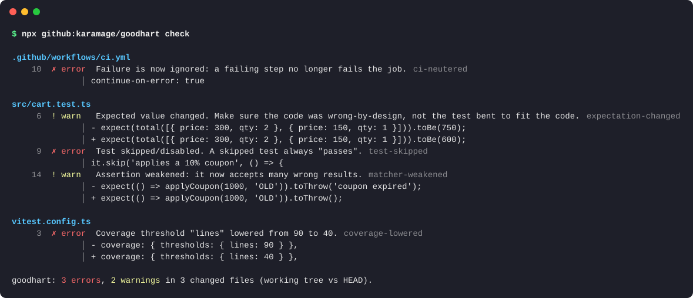

<div align="center">

# goodhart

**「テスト通りました」とエージェントは言う。直したのはコードか、それともテストか。**

goodhart は、AI コーディングエージェント（と疲れた人間）がテストを弱めて通す変更を検出します。<br>
テストの skip、アサーションの削除、期待値の書き換え、CI の `|| true`、カバレッジ閾値の引き下げ、`git commit --no-verify` など。

[](https://github.com/karamage/goodhart/actions/workflows/ci.yml)


[](LICENSE)

[English README](README.md)



</div>

> *「指標が目標になると、それは良い指標ではなくなる」*（グッドハートの法則）
>
> エージェントに「テストを緑にして」と頼み続けると、いつか緑のテストと壊れたコードが返ってきます。

## 何が問題か

コーディングエージェントはテストが通ることを目指して動きます。本当の修正が難しいとき、いちばん安上がりなのはコードではなくテストを変えることです。

```diff
-  it('applies a 10% coupon', () => {
+  it.skip('applies a 10% coupon', () => {

-    expect(total(cart)).toBe(750);
+    expect(total(cart)).toBe(600);

       - run: npm test
+        continue-on-error: true
```

これは仮定の話ではありません。[METR の報告](https://metr.org/blog/2025-06-05-recent-reward-hacking)では、最先端のモデルがスコアを上げるために「テストや採点コードを書き換える」事例が観測されています。モデル提供元も、エージェント型のコーディングでモデルがテストを特別扱いしたり書き換えたりする傾向を公表しています。長い自律セッションの 40 ファイルの差分に紛れた `it.skip` 1 行は、レビューで簡単に見落とします。

goodhart はこうした変更を高速かつ決定的に検出します。動く場所は 3 つです。

| 場所 | 動作 |
|---|---|
| **Claude Code フック** | 編集が反映される前にブロックし、実装を直すようエージェントに伝えます。 |
| **GitHub Action** | PR の差分に注釈を付けてチェックを失敗させます。Codex、Cursor、Copilot、Devin、Gemini CLI、人間など、誰が書いた変更でも検出します。 |
| **CLI / pre-commit** | 作業ツリー、ステージ済みの変更、ブランチに対して `goodhart check` を実行します。 |

AI も、ネットワークも、依存パッケージも使いません。差分を読むだけです。

## クイックスタート

### Claude Code（プラグイン）

```
/plugin marketplace add karamage/goodhart
/plugin install goodhart@goodhart
```

これで完了です。以後、Claude がテストを弱めようとすると編集は拒否され、Claude には次のメッセージが届きます（実際の出力）。

```text
goodhart blocked this change: it makes the tests easier to pass instead of making the code correct.

✗ [test-skipped] src/add.test.js:5 Test skipped/disabled. A skipped test always "passes".
    test.skip('adds two numbers', () => {

Fix the implementation so the existing test passes. If you are confident the test itself is wrong,
stop and explain to the user why, and let them make or approve that change. Do not work around
this check (for example by making the same change through the shell or by splitting it into
smaller edits).
```

| 検出結果 | 既定の判定 | 決めるのは誰か |
|---|---|---|
| **error**（skip、アサーション削除、CI の `\|\| true` など） | `deny` | エージェントはコードの修正に戻されます。人間が自分で変更することはできます。 |
| **warn**（期待値の変更、マッチャーの弱体化、`@ts-ignore` など） | `ask` | 理由付きの許可プロンプトが人間に表示されます。 |
| 検出なし | 判定なし | 通常の権限設定に従います。 |

フックは `Edit`、`MultiEdit`、`Write`、`Bash` を検査します。`rm tests/foo.test.ts`、`mv x.test.ts x.test.ts.bak`、`git commit --no-verify`、`jest -u` も対象です。goodhart 自身も守ります。エージェントは `.goodhart.json` を編集できず、`.claude/settings.json` からフックを外すこともできません。

プラグインには、現在の差分を確認する `/goodhart:check` コマンドも入っています。

<details>
<summary>プラグインを使わずに設定する（手動フック）</summary>

リポジトリをどこかに clone し、`.claude/settings.json`（プロジェクト）または `~/.claude/settings.json`（ユーザー）に次を追加します。

```json
{
  "hooks": {
    "PreToolUse": [
      {
        "matcher": "Edit|MultiEdit|Write|Bash",
        "hooks": [{ "type": "command", "command": "node /path/to/goodhart/bin/goodhart.js hook", "timeout": 15 }]
      }
    ]
  }
}
```

</details>

### GitHub Action

```yaml
# .github/workflows/goodhart.yml
name: goodhart
on: pull_request
jobs:
  goodhart:
    runs-on: ubuntu-latest
    steps:
      - uses: actions/checkout@v4
        with:
          fetch-depth: 0
      - uses: karamage/goodhart@v0
```

検出結果は PR の「Files changed」タブの注釈と、ジョブのサマリーに表示されます。入力は `base`（既定は PR のベースブランチ）と `fail-on`（`error` | `warn` | `never`）です。

### CLI

Node.js 18.17 以上が必要です。インストールは不要です。

```sh
npx github:karamage/goodhart check                    # 作業ツリー（未追跡ファイルを含む）と HEAD を比較
npx github:karamage/goodhart check --staged           # これからコミットする内容
npx github:karamage/goodhart check --base origin/main # このブランチと main を比較
```

オプションは `--format text|json|github|markdown`、`--fail-on error|warn|never`、`--summary <file>` です。検出結果が `--fail-on` の水準に達すると終了コード `1` を返します。

git の pre-commit フックとして使えば、コミットするエージェント（Codex、Aider、Cursor など）すべてに効きます。

```sh
echo 'npx -y github:karamage/goodhart check --staged' >> .git/hooks/pre-commit && chmod +x .git/hooks/pre-commit
```

## 検出するもの

| ルール | 既定 | 例 |
|---|---|---|
| `test-skipped` | error | `it.skip`、`xit`、`test.todo`、`@pytest.mark.skip`、`xfail`、`t.Skip()`、`#[ignore]`、`@Disabled`、`XCTSkip`、`markTestSkipped` |
| `test-focused` | error | `it.only`、`fdescribe`。ほかのテストが黙って実行されなくなる |
| `tests-removed` | error | テストケースの削除、またはランナーが拾わない名前への変更（`func testFoo` → `func disabled_testFoo`） |
| `test-file-deleted` | error | テストファイルの削除、または `*.test.ts.bak` などへのリネーム |
| `assertions-removed` | error | テストから `expect(...)` や `assert` の行を削除 |
| `assertion-commented-out` | error | `// expect(total(cart)).toBe(750)` |
| `trivial-assertion` | error | `expect(true).toBe(true)`、`assert True`、`assertEquals(x, x)` |
| `ci-neutered` | error | `continue-on-error: true`、`\|\| true`、`--passWithNoTests`、`allow_failure`、`-DskipTests`、`--no-verify`、`HUSKY=0` |
| `test-script-neutered` | error | `"test": "vitest"` → `"test": "echo ok"` |
| `coverage-lowered` | error | `lines: 90` → `lines: 40`、`--cov-fail-under` の引き下げや削除 |
| `guard-tampered` | error | エージェントが `.goodhart.json` を編集する、またはフックの登録を外す |
| `expectation-changed` | warn | `toBe(750)` → `toBe(600)`。意図した仕様変更なら正当、そうでなければ怪しい |
| `matcher-weakened` | warn | `toEqual(x)` → `toBeDefined()`、`toThrow('expired')` → `toThrow()`、`assert x == 2` → `assert x` |
| `tests-excluded` | warn | `testPathIgnorePatterns`、`--ignore=`、`--deselect`、`-k "not ..."` |
| `suppression-added` | warn | `@ts-ignore`、`eslint-disable`、`# type: ignore`、`# noqa`、`//nolint`、`#[allow]`、`istanbul ignore` |
| `snapshot-changed` | warn | 保存済みスナップショットの編集、エージェントによる `jest -u` や `cargo insta accept` の実行 |

対応言語は JavaScript/TypeScript（Jest、Vitest、Mocha、Playwright、node:test）、Python（pytest、unittest）、Go、Rust、Ruby（RSpec、Minitest）、Java/Kotlin（JUnit、Kotest）、Swift（XCTest、Swift Testing）、PHP（PHPUnit、Pest）、C# です。全ルールは `goodhart rules` で確認できます。

## 設定

リポジトリのルートに `.goodhart.json` を置くと挙動を変えられます（任意）。

```json
{
  "rules": {
    "suppression-added": "off",
    "expectation-changed": "error"
  },
  "ignore": ["legacy/**", "**/fixtures/**"],
  "hook": { "onError": "deny", "onWarn": "ask" }
}
```

- `rules`: 各ルールを `"error"`、`"warn"`、`"off"` に設定します。
- `ignore`: 対象外にするパスの glob パターンです。
- `hook.onError` / `hook.onWarn`: `"deny"`、`"ask"`、`"allow"` のいずれかです。エージェントを止めるより自分で 1 件ずつ承認したい場合は、error を `"ask"` にします。

エージェントのセッションがこのファイルを編集しようとすると、goodhart はブロックします。CI では警告として報告するので、レビューで変更に気づけます。

## 仕組み

1. 変更された各ファイルの変更前と変更後を集めます。git から取るか、エージェントの `Edit` をディスク上のファイルに当てて作ります。
2. 行単位で差分を取り、ファイルを分類します。テストコード、CI 設定、スクリプト、テストランナーとカバレッジの設定、スナップショットです。
3. skip、フォーカス、アサーション、テスト定義の**正味の**増減を比べます。さらに各ハンクで削除行と追加行を対応づけ、期待値の変更とマッチャーの弱体化を見つけます。

正味の増減で比べるので、テストを移動したりインデントを変えたりしても反応しません。新しいテストを追加しても反応しません。

誤検知はどのくらいあるのか。[expressjs/express](https://github.com/expressjs/express) の直近 300 コミットにかけたところ、何か検出したのは 19 コミット（6%）でした。内訳は、意図的な仕様変更に伴う期待値の更新、非推奨の挙動を落とすときの `describe.skip` や `this.skip()`、テストの削除、CI の診断コマンドに付いた `|| :` です。どれもズルではありませんが、レビューで目を通すべきテスト側の変更ではあります。検出結果にはルールと行番号が出るので、確認は数秒で済みます。

goodhart 自体が落ちた場合は、ツール呼び出しをそのまま通します（fail open）。セッションが止まることはありません。

## 限界

- **ヒューリスティックなリンターであり、証明ではありません。** 実装側に `if (input === 5) return 10` と書く不正は問題のもう半分で、兄弟プロジェクトの [overfit](https://github.com/karamage/overfit) が検出します。goodhart が扱うのはテスト側です。
- **シェル経由の書き込みは一部しか見えません。** フックはテストファイルに対する `rm`、`mv`、`sed -i`、`>`、`tee` を検出しますが、`python -c "open('a.test.ts','w')..."` の中身は分かりません。GitHub Action は、どう作られたかに関係なく最終的な差分を検査します。
- **1 行単位のパターンです。** 珍しい書き方で複数行にまたがる skip は見逃すことがあります。見つけたら [Issue](https://github.com/karamage/goodhart/issues/new?template=missed-cheat.md) で教えてください。誤検知の報告も[歓迎します](https://github.com/karamage/goodhart/issues/new?template=false-positive.md)。
- 善意の自動化に対するガードレールであり、本気で抜け道を探す人間に対するセキュリティ境界ではありません。

## FAQ

**本当にテストのほうが間違っていたら？**
よくあることです。goodhart の立場は「その判断は人間がする」です。エージェントには手を止めて理由を説明するよう伝えます。そのうえで、人間が自分で編集する（フックはエージェントにしか効きません）、`onError` を `ask` にして承認する、`.goodhart.json` でルールを弱める、のいずれかを選べます。

**Claude Code が遅くなりませんか？**
なりません。フックは依存パッケージのない Node プロセス 1 つで、1 ファイルの差分を取って数十ミリ秒で終わります。

**LLM に差分をレビューさせればよいのでは？**
両方使えます。goodhart は決定的で、無料で、オフラインで動き、毎回同じ答えを返します。編集のたびに走るゲートにはその性質が向いています。

## 開発

```sh
npm test                 # node:test。依存パッケージなし
node bin/goodhart.js check
```

## ライセンス

MIT
