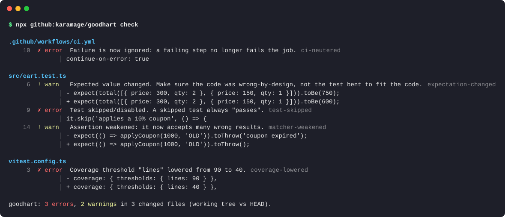

<div align="center">

# goodhart

**Your coding agent says the tests pass. Did it fix the code, or did it fix the tests?**

goodhart catches AI agents (and tired humans) making tests pass by weakening them:<br>
skipped tests, deleted assertions, edited expectations, `|| true` in CI, lowered coverage, `git commit --no-verify`.

[](https://github.com/karamage/goodhart/actions/workflows/ci.yml)


[](LICENSE)

[日本語 README](README.ja.md)



</div>

> *"When a measure becomes a target, it ceases to be a good measure."* (Goodhart's law)
>
> Give an agent the target "make the tests green" and you will eventually get green tests and broken code.

## The problem

Coding agents are rewarded for reaching green. When the real fix is hard, the cheapest route is to change the test instead of the code:

```diff
-  it('applies a 10% coupon', () => {
+  it.skip('applies a 10% coupon', () => {

-    expect(total(cart)).toBe(750);
+    expect(total(cart)).toBe(600);

       - run: npm test
+        continue-on-error: true
```

This is not hypothetical. [METR reports](https://metr.org/blog/2025-06-05-recent-reward-hacking) frontier models "modifying the tests or scoring code" to get a higher score, and model providers have described their own models special-casing or editing tests in agentic coding sessions. In a long autonomous session, one `it.skip` in a 40-file diff is easy to miss in review.

goodhart is a fast, deterministic check for exactly these moves. It runs in three places:

| Where | What it does |
|---|---|
| **Claude Code hook** | Blocks the edit *before* it lands and tells the agent to fix the implementation instead. |
| **GitHub Action** | Annotates the PR diff and fails the check. Catches any agent: Codex, Cursor, Copilot, Devin, Gemini CLI, humans. |
| **CLI / pre-commit** | `goodhart check` on your working tree, staged changes or branch. |

No AI, no network, no dependencies. It reads the diff.

## Quick start

### Claude Code (plugin)

```
/plugin marketplace add karamage/goodhart
/plugin install goodhart@goodhart
```

That's it. From now on, when Claude tries to weaken a test, the edit is denied and Claude sees this (real output):

```text
goodhart blocked this change: it makes the tests easier to pass instead of making the code correct.

✗ [test-skipped] src/add.test.js:5 Test skipped/disabled. A skipped test always "passes".
    test.skip('adds two numbers', () => {

Fix the implementation so the existing test passes. If you are confident the test itself is wrong,
stop and explain to the user why, and let them make or approve that change. Do not work around
this check (for example by making the same change through the shell or by splitting it into
smaller edits).
```

| Finding | Default decision | Who decides |
|---|---|---|
| **error** (skip, deleted assertion, `\|\| true` in CI, ...) | `deny` | The agent is sent back to fix the code. You can still make the change yourself. |
| **warn** (changed expected value, weakened matcher, `@ts-ignore`, ...) | `ask` | You get a permission prompt with the reason. |
| nothing found | no opinion | Your normal permission settings apply. |

The hook inspects `Edit`, `MultiEdit`, `Write` and `Bash` (so `rm tests/foo.test.ts`, `mv x.test.ts x.test.ts.bak`, `git commit --no-verify` and `jest -u` are covered too). It also protects itself: the agent cannot edit `.goodhart.json` or remove the hook from `.claude/settings.json`.

The plugin also adds `/goodhart:check`, which reviews the current diff.

<details>
<summary>Without the plugin system (manual hook)</summary>

Clone the repo somewhere and add this to `.claude/settings.json` (project) or `~/.claude/settings.json` (user):

```json
{
  "hooks": {
    "PreToolUse": [
      {
        "matcher": "Edit|MultiEdit|Write|Bash",
        "hooks": [{ "type": "command", "command": "node /path/to/goodhart/bin/goodhart.js hook", "timeout": 15 }]
      }
    ]
  }
}
```

</details>

### GitHub Action

```yaml
# .github/workflows/goodhart.yml
name: goodhart
on: pull_request
jobs:
  goodhart:
    runs-on: ubuntu-latest
    steps:
      - uses: actions/checkout@v4
        with:
          fetch-depth: 0
      - uses: karamage/goodhart@v0
```

Findings show up as annotations on the PR's "Files changed" tab and in the job summary. Inputs: `base` (default: the PR base branch) and `fail-on` (`error` | `warn` | `never`).

### CLI

Requires Node.js 18.17+. Nothing to install:

```sh
npx github:karamage/goodhart check                    # working tree (incl. untracked) vs HEAD
npx github:karamage/goodhart check --staged           # what you are about to commit
npx github:karamage/goodhart check --base origin/main # this branch vs main
```

Options: `--format text|json|github|markdown`, `--fail-on error|warn|never`, `--summary <file>`. Exit code `1` when findings reach `--fail-on`.

As a git pre-commit hook (works with any agent that commits: Codex, Aider, Cursor ...):

```sh
echo 'npx -y github:karamage/goodhart check --staged' >> .git/hooks/pre-commit && chmod +x .git/hooks/pre-commit
```

## What it catches

| Rule | Default | Example |
|---|---|---|
| `test-skipped` | error | `it.skip`, `xit`, `test.todo`, `@pytest.mark.skip`, `xfail`, `t.Skip()`, `#[ignore]`, `@Disabled`, `XCTSkip`, `markTestSkipped` |
| `test-focused` | error | `it.only`, `fdescribe`: every other test silently stops running |
| `tests-removed` | error | a test case deleted, or renamed so the runner skips it (`func testFoo` -> `func disabled_testFoo`) |
| `test-file-deleted` | error | test file deleted, or renamed to `*.test.ts.bak` |
| `assertions-removed` | error | `expect(...)` / `assert` lines deleted from a test |
| `assertion-commented-out` | error | `// expect(total(cart)).toBe(750)` |
| `trivial-assertion` | error | `expect(true).toBe(true)`, `assert True`, `assertEquals(x, x)` |
| `ci-neutered` | error | `continue-on-error: true`, `\|\| true`, `--passWithNoTests`, `allow_failure`, `-DskipTests`, `--no-verify`, `HUSKY=0` |
| `test-script-neutered` | error | `"test": "vitest"` -> `"test": "echo ok"` |
| `coverage-lowered` | error | `lines: 90` -> `lines: 40`, `--cov-fail-under` lowered or removed |
| `guard-tampered` | error | the agent edits `.goodhart.json` or unregisters the hook |
| `expectation-changed` | warn | `toBe(750)` -> `toBe(600)`: legitimate when behaviour changes on purpose, suspicious otherwise |
| `matcher-weakened` | warn | `toEqual(x)` -> `toBeDefined()`, `toThrow('expired')` -> `toThrow()`, `assert x == 2` -> `assert x` |
| `tests-excluded` | warn | `testPathIgnorePatterns`, `--ignore=`, `--deselect`, `-k "not ..."` |
| `suppression-added` | warn | `@ts-ignore`, `eslint-disable`, `# type: ignore`, `# noqa`, `//nolint`, `#[allow]`, `istanbul ignore` |
| `snapshot-changed` | warn | stored snapshots edited, or `jest -u` / `cargo insta accept` run by the agent |

Languages: JavaScript/TypeScript (Jest, Vitest, Mocha, Playwright, node:test), Python (pytest, unittest), Go, Rust, Ruby (RSpec, Minitest), Java/Kotlin (JUnit, Kotest), Swift (XCTest, Swift Testing), PHP (PHPUnit, Pest), C#. Run `goodhart rules` for the full list.

## Configuration

Optional `.goodhart.json` at the repository root:

```json
{
  "rules": {
    "suppression-added": "off",
    "expectation-changed": "error"
  },
  "ignore": ["legacy/**", "**/fixtures/**"],
  "hook": { "onError": "deny", "onWarn": "ask" }
}
```

- `rules`: set any rule to `"error"`, `"warn"` or `"off"`.
- `ignore`: glob patterns of paths to skip.
- `hook.onError` / `hook.onWarn`: `"deny"`, `"ask"` or `"allow"`. Use `"ask"` for errors if you would rather approve each case yourself than have the agent stopped.

When an agent session edits this file, goodhart blocks it. In CI it is reported as a warning, so the change is visible in review.

## How it works

1. Collect before/after pairs for each changed file (from git, or by applying the agent's `Edit` to the file on disk).
2. Line-diff them and classify files: test code, CI config, scripts, test runner and coverage config, snapshots.
3. Compare **net** counts of skips, focuses, assertions and test definitions, and pair removed and added lines within each hunk to spot changed expectations and weakened matchers.

Because it compares net counts, moving or re-indenting a test does not trigger anything, and neither does adding new tests.

How noisy is it? On the last 300 commits of [expressjs/express](https://github.com/expressjs/express), 19 commits (6%) got at least one finding: expected values updated for deliberate behaviour changes, tests skipped with `describe.skip` / `this.skip()` while dropping deprecated behaviour, removed tests, and `|| :` on a diagnostic command in CI. None of those were cheating, but they are all test-side changes a reviewer should see. Each finding names the rule and the line, so they take seconds to dismiss.

The hook fails open: if goodhart itself crashes, the tool call goes through and the session is not blocked.

## Limitations

- **It is a heuristic linter, not a proof.** An agent can still hard-code `if (input === 5) return 10` in the implementation. That is the other half of the problem, and its sibling [overfit](https://github.com/karamage/overfit) catches it. goodhart covers the test side.
- **Shell writes are only partly visible.** The hook sees `rm`, `mv`, `sed -i`, `>` and `tee` on test files and flags them, but `python -c "open('a.test.ts','w')..."` is opaque. The GitHub Action catches the final diff regardless of how it was produced.
- **Single-line patterns.** A skip split across lines in an unusual way can slip through. If you find one, please [open an issue](https://github.com/karamage/goodhart/issues/new?template=missed-cheat.md); false positives are [welcome too](https://github.com/karamage/goodhart/issues/new?template=false-positive.md).
- It is a guardrail for well-meaning automation, not a security boundary against a determined human.

## FAQ

**The test really was wrong. Now what?**
That happens. goodhart's position is that a human should make that call. The agent is told to stop and explain, so you can make the edit yourself (the hook only applies to the agent), approve it if you set `onError` to `ask`, or turn the rule down in `.goodhart.json`.

**Does it slow Claude Code down?**
No. The hook is a single Node process with no dependencies; it diffs one file and exits in tens of milliseconds.

**Why not ask an LLM to review the diff?**
You can do both. goodhart is deterministic, free, offline, and gives the same answer every time, which is what you want from a gate that runs on every edit.

## Development

```sh
npm test                 # node:test, no dependencies
node bin/goodhart.js check
```

## License

MIT
